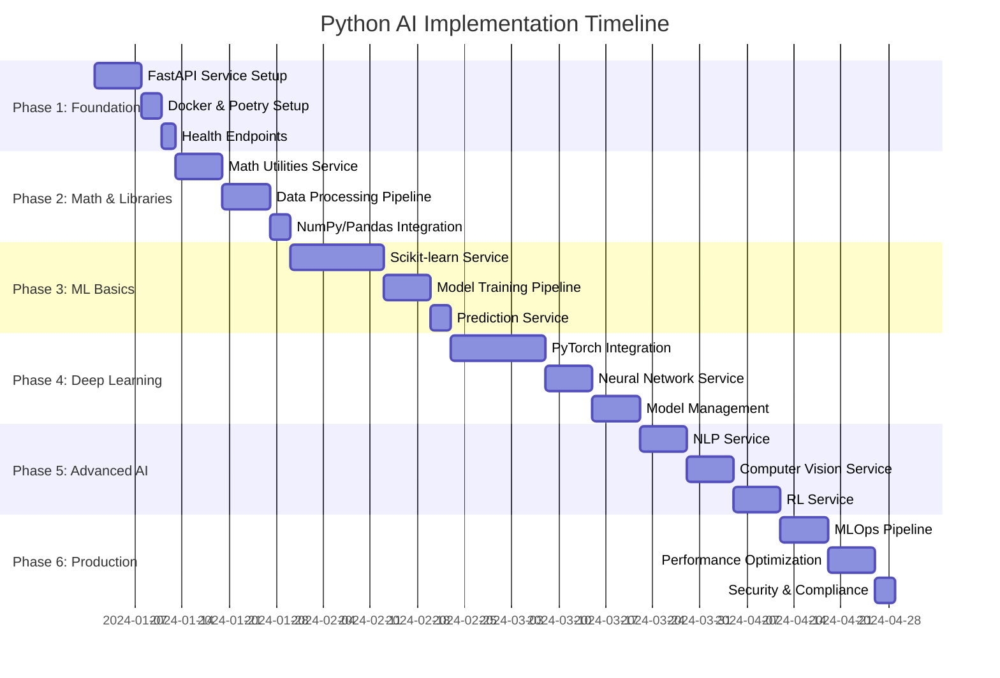

# 🧠 Python AI Implementation Pipeline
## Connecting Advanced AI Learning with Cogerphere Python Service

---

## 📋 Overview

This document creates a comprehensive implementation pipeline that connects your **Advanced AI Learning Roadmap** with the **Python Additions** from `pythonaddtions.md`. Each phase maps specific AI concepts to practical implementations in our FastAPI service, creating a hands-on learning experience.

---

## 🏗️ Architecture Integration Map

### Current Tech Stack Integration
```
┌─────────────────────────────────────────────────────────────────┐
│                    COGERPHERE ECOSYSTEM                        │
├─────────────────────────────────────────────────────────────────┤
│  Frontend (Next.js + React)                                    │
│  ├── TanStack Query (State Management)                         │
│  ├── tRPC (Type-safe APIs)                                     │
│  └── Shadcn UI (Components)                                    │
├─────────────────────────────────────────────────────────────────┤
│  Backend Services                                               │
│  ├── Next.js API Routes (tRPC)                                 │
│  ├── Inngest (Background Jobs)                                 │
│  ├── Prisma + PostgreSQL (Database)                            │
│  └── 🆕 FastAPI Python Service (AI/ML Engine)                  │
├─────────────────────────────────────────────────────────────────┤
│  AI/ML Capabilities                                             │
│  ├── OpenAI API (Current)                                       │
│  ├── E2B Code Interpreter (Sandbox)                             │
│  └── 🆕 Python ML Pipeline (New)                                │
└─────────────────────────────────────────────────────────────────┘
```

---

## 🎯 Phase-by-Phase Implementation Plan

### Phase 1: Foundation & Python Basics 🐍
**Duration**: 1-2 weeks  
**Learning Focus**: Python fundamentals, FastAPI, Docker

#### Implementation Tasks
1. **FastAPI Service Skeleton**
   - Create `py-service/` directory structure
   - Set up Poetry for dependency management
   - Implement basic FastAPI app with health endpoints
   - Dockerize the service

#### Learning Resources
- **Python Basics**: Functions, OOP, file handling
- **FastAPI**: [Official Documentation](https://fastapi.tiangolo.com)
- **Poetry**: [Python Poetry Guide](https://python-poetry.org/docs/)
- **Docker**: [Docker Python Guide](https://docs.docker.com/language/python/)

#### Code Structure
```
py-service/
├── pyproject.toml          # Poetry configuration
├── Dockerfile              # Container definition
├── docker-compose.yml      # Local development
├── src/
│   ├── main.py            # FastAPI app entry point
│   ├── models/            # Pydantic models
│   ├── routers/           # API endpoints
│   ├── services/          # Business logic
│   └── utils/             # Utilities
└── tests/                 # Test suite
```

#### Integration Points
- **tRPC Integration**: Add `pythonService` client in Next.js
- **Health Monitoring**: Connect to existing observability stack
- **Database**: Extend Prisma schema for Python service data

---

### Phase 2: Math for ML & Essential Libraries 📘
**Duration**: 2-3 weeks  
**Learning Focus**: Linear Algebra, Probability, NumPy, Pandas

#### Implementation Tasks
1. **Math Utilities Service**
   - Create `/math/linear-algebra` endpoint
   - Implement matrix operations, eigenvalues, SVD
   - Add probability distributions and statistical functions

2. **Data Processing Pipeline**
   - Create `/data/process` endpoint using Pandas
   - Implement CSV/JSON data transformation
   - Add data validation and cleaning utilities

#### Learning Resources
- **Linear Algebra**: [Khan Academy Linear Algebra](https://www.khanacademy.org/math/linear-algebra)
- **NumPy**: [NumPy User Guide](https://numpy.org/doc/stable/user/index.html)
- **Pandas**: [Pandas Documentation](https://pandas.pydata.org/docs/)
- **Probability**: [MIT Probability Course](https://ocw.mit.edu/courses/mathematics/18-05-introduction-to-probability-and-statistics-spring-2014/)

#### API Endpoints
```python
# Math Operations
POST /math/matrix-operations
{
  "operation": "eigenvalues" | "svd" | "determinant",
  "matrix": [[1, 2], [3, 4]]
}

# Data Processing
POST /data/process
{
  "data": {...},
  "operations": ["clean", "transform", "validate"]
}
```

#### Integration with Current System
- **Fragment Processing**: Use math utilities for data analysis in fragments
- **Project Analytics**: Add mathematical analysis to project insights
- **Message Enhancement**: Process structured data in messages

---

### Phase 3: Machine Learning Basics 🤖
**Duration**: 3-4 weeks  
**Learning Focus**: Scikit-learn, ML algorithms, model evaluation

#### Implementation Tasks
1. **ML Training Service**
   - Implement `/ml/train` endpoint with Scikit-learn
   - Support multiple algorithms (Linear Regression, Decision Trees, etc.)
   - Add model evaluation and cross-validation

2. **Prediction Service**
   - Create `/ml/predict` endpoint
   - Implement model persistence and loading
   - Add batch prediction capabilities

#### Learning Resources
- **Scikit-learn**: [Scikit-learn User Guide](https://scikit-learn.org/stable/user_guide.html)
- **ML Algorithms**: [Hands-On Machine Learning](https://www.oreilly.com/library/view/hands-on-machine-learning/9781492032632/)
- **Model Evaluation**: [ML Evaluation Metrics](https://scikit-learn.org/stable/modules/model_evaluation.html)

#### API Endpoints
```python
# Model Training
POST /ml/train
{
  "algorithm": "linear_regression" | "decision_tree" | "random_forest",
  "data": {"X": [...], "y": [...]},
  "test_size": 0.2
}

# Predictions
POST /ml/predict
{
  "model_id": "uuid",
  "data": [...]
}
```

#### Integration with Current System
- **Code Quality**: Use ML to predict code quality scores
- **User Behavior**: Analyze user interaction patterns
- **Project Recommendations**: ML-based project suggestions

---

### Phase 4: Deep Learning & Neural Networks 🧬
**Duration**: 4-5 weeks  
**Learning Focus**: PyTorch, Neural Networks, CNNs, RNNs

#### Implementation Tasks
1. **Neural Network Service**
   - Implement `/dl/train` endpoint with PyTorch
   - Support CNN, RNN, LSTM architectures
   - Add transfer learning capabilities

2. **Model Management**
   - Create model versioning system
   - Implement model serving infrastructure
   - Add model performance monitoring

#### Learning Resources
- **PyTorch**: [PyTorch Tutorials](https://pytorch.org/tutorials/)
- **Neural Networks**: [Deep Learning Book](https://www.deeplearningbook.org/)
- **CNNs**: [CS231n Stanford Course](http://cs231n.stanford.edu/)
- **RNNs**: [Understanding LSTM Networks](https://colah.github.io/posts/2015-08-Understanding-LSTMs/)

#### API Endpoints
```python
# Deep Learning Training
POST /dl/train
{
  "architecture": "cnn" | "rnn" | "transformer",
  "data": {...},
  "hyperparameters": {...}
}

# Model Inference
POST /dl/infer
{
  "model_id": "uuid",
  "input": {...}
}
```

#### Integration with Current System
- **Code Generation**: Use transformers for better code generation
- **Image Processing**: Add image analysis capabilities to fragments
- **Natural Language**: Enhance NLP processing in messages

---

### Phase 5: Advanced AI Features 🧩
**Duration**: 3-4 weeks  
**Learning Focus**: NLP, Computer Vision, Reinforcement Learning

#### Implementation Tasks
1. **NLP Service** (from roadmap)
   - Implement `/nlp/spec` endpoint
   - Add sentiment analysis, text classification
   - Create text summarization capabilities

2. **Computer Vision Service**
   - Implement `/cv/analyze` endpoint
   - Add image classification, object detection
   - Create image generation capabilities

3. **Reinforcement Learning Service**
   - Implement `/rl/train` endpoint
   - Add Q-learning, policy gradient methods
   - Create environment simulation

#### Learning Resources
- **NLP**: [Natural Language Processing with Python](https://www.nltk.org/book/)
- **Computer Vision**: [OpenCV Documentation](https://docs.opencv.org/)
- **Reinforcement Learning**: [Sutton & Barto Book](http://incompleteideas.net/book/the-book-2nd.html)

#### API Endpoints
```python
# NLP Processing
POST /nlp/spec
{
  "prompt": "Create a user authentication system",
  "output_format": "structured"
}

# Computer Vision
POST /cv/analyze
{
  "image_url": "https://...",
  "tasks": ["classification", "detection"]
}

# Reinforcement Learning
POST /rl/train
{
  "environment": "custom",
  "algorithm": "q_learning"
}
```

---

### Phase 6: Production Integration & Optimization 🚀
**Duration**: 2-3 weeks  
**Learning Focus**: Production ML, MLOps, Performance Optimization

#### Implementation Tasks
1. **MLOps Pipeline**
   - Implement model versioning and deployment
   - Add automated retraining pipelines
   - Create model monitoring and alerting

2. **Performance Optimization**
   - Implement caching strategies
   - Add batch processing capabilities
   - Optimize model inference speed

3. **Security & Compliance**
   - Add data privacy controls
   - Implement audit logging
   - Create compliance reporting

#### Learning Resources
- **MLOps**: [MLOps Guide](https://ml-ops.org/)
- **Production ML**: [Designing Machine Learning Systems](https://www.oreilly.com/library/view/designing-machine-learning/9781098107956/)
- **Performance**: [High Performance Python](https://www.oreilly.com/library/view/high-performance-python/9781449361747/)

---

## 🔗 Integration Mapping

### Current System Components → Python Service

| Current Component | Python Service Endpoint | Learning Topic | Implementation |
|-------------------|------------------------|----------------|----------------|
| `Message.fragments` | `/ml/embed` | Vector Embeddings | Sentence Transformers |
| `Project` creation | `/nlp/spec` | NLP Processing | Prompt Engineering |
| Code generation | `/code/quality` | Code Analysis | Static Analysis |
| File processing | `/data/csv-to-api` | Data Processing | Pandas, Schema Inference |
| Web scraping | `/web/scrape` | Web Scraping | BeautifulSoup, Requests |
| Background jobs | `/ai/route` | AI Orchestration | Model Routing |

### Learning Path → Practical Implementation

| Learning Topic | Python Service Feature | Real-World Application |
|----------------|------------------------|------------------------|
| **Python Basics** | FastAPI Service Foundation | API Development |
| **Math for ML** | Mathematical Operations | Data Analysis |
| **NumPy/Pandas** | Data Processing Pipeline | CSV/JSON Handling |
| **Scikit-learn** | ML Training Service | Predictive Analytics |
| **PyTorch** | Deep Learning Service | Neural Network Training |
| **NLP** | Text Processing Service | Code Specification Generation |
| **Computer Vision** | Image Analysis Service | Visual Code Analysis |
| **Reinforcement Learning** | RL Training Service | Adaptive Code Generation |

---

## 📊 Implementation Timeline



---

## 🎓 Learning Projects Integration

### Project 1: Spam Email Classifier
**Implementation**: `/ml/train` endpoint with email classification
**Learning**: Text preprocessing, feature extraction, model evaluation
**Integration**: Use in message filtering system

### Project 2: Movie Recommendation System
**Implementation**: `/ml/recommend` endpoint with collaborative filtering
**Learning**: Recommendation algorithms, matrix factorization
**Integration**: Project recommendation system

### Project 3: Handwritten Digit Recognition
**Implementation**: `/dl/train` endpoint with CNN
**Learning**: Image preprocessing, CNN architecture, model training
**Integration**: Code diagram recognition

### Project 4: Sentiment Analysis of Tweets
**Implementation**: `/nlp/sentiment` endpoint
**Learning**: NLP preprocessing, sentiment classification
**Integration**: Message sentiment analysis

### Project 5: Image Classifier
**Implementation**: `/cv/classify` endpoint
**Learning**: Image classification, transfer learning
**Integration**: Screenshot analysis for code generation

---

## 🔧 Technical Implementation Details

### Database Schema Extensions
```sql
-- Add to existing Prisma schema
model MLModel {
  id          String   @id @default(uuid())
  name        String
  type        String   // "classification", "regression", "neural_network"
  algorithm   String   // "linear_regression", "cnn", "transformer"
  version     String
  accuracy    Float?
  createdAt   DateTime @default(now())
  updatedAt   DateTime @updatedAt
  projectId   String
  project     Project  @relation(fields: [projectId], references: [id])
  predictions Prediction[]
}

model Prediction {
  id        String   @id @default(uuid())
  input     Json
  output    Json
  confidence Float?
  createdAt DateTime @default(now())
  modelId   String
  model     MLModel  @relation(fields: [modelId], references: [id])
}

model Embedding {
  id        String   @id @default(uuid())
  text      String
  vector    Float[]  // pgvector extension
  model     String
  createdAt DateTime @default(now())
  projectId String
  project   Project  @relation(fields: [projectId], references: [id])
}
```

### FastAPI Service Structure
```python
# src/routers/ml.py
from fastapi import APIRouter, Depends
from pydantic import BaseModel
from typing import List, Optional

router = APIRouter(prefix="/ml", tags=["machine-learning"])

class TrainingRequest(BaseModel):
    algorithm: str
    data: dict
    test_size: float = 0.2

class PredictionRequest(BaseModel):
    model_id: str
    data: List[float]

@router.post("/train")
async def train_model(request: TrainingRequest):
    # Implement ML training logic
    pass

@router.post("/predict")
async def make_prediction(request: PredictionRequest):
    # Implement prediction logic
    pass
```

### Next.js Integration
```typescript
// src/lib/python-service.ts
export class PythonServiceClient {
  private baseUrl: string;
  private apiKey: string;

  constructor() {
    this.baseUrl = process.env.PYTHON_SERVICE_URL!;
    this.apiKey = process.env.PYTHON_SERVICE_API_KEY!;
  }

  async trainModel(data: TrainingRequest) {
    const response = await fetch(`${this.baseUrl}/ml/train`, {
      method: 'POST',
      headers: {
        'Content-Type': 'application/json',
        'Authorization': `Bearer ${this.apiKey}`
      },
      body: JSON.stringify(data)
    });
    return response.json();
  }

  async makePrediction(data: PredictionRequest) {
    const response = await fetch(`${this.baseUrl}/ml/predict`, {
      method: 'POST',
      headers: {
        'Content-Type': 'application/json',
        'Authorization': `Bearer ${this.apiKey}`
      },
      body: JSON.stringify(data)
    });
    return response.json();
  }
}
```

---

## 🎯 Success Metrics

### Learning Progress Tracking
- **Code Quality**: Measure improvement in generated code quality
- **Model Accuracy**: Track ML model performance over time
- **Response Time**: Monitor API response times and optimization
- **User Engagement**: Measure feature adoption and usage

### Technical Metrics
- **API Uptime**: 99.9% availability target
- **Response Time**: <500ms for simple operations, <5s for complex ML tasks
- **Model Accuracy**: >90% for classification tasks
- **Error Rate**: <1% for production endpoints

---

## 🚀 Getting Started

### Prerequisites
- Python 3.11+
- Docker and Docker Compose
- Node.js 18+ (existing)
- PostgreSQL with pgvector extension

### Quick Start Commands
```bash
# 1. Set up Python service
cd py-service
poetry install
poetry run uvicorn src.main:app --reload

# 2. Run with Docker
docker-compose up -d

# 3. Test integration
curl -X GET http://localhost:8000/health
```

### Development Workflow
1. **Local Development**: Use Poetry for Python dependencies
2. **Testing**: Run pytest for Python service tests
3. **Integration**: Use Docker Compose for full stack testing
4. **Deployment**: Deploy Python service separately from Next.js app

---

## 📚 Additional Learning Resources

### Books
- [Hands-On Machine Learning](https://www.oreilly.com/library/view/hands-on-machine-learning/9781492032632/)
- [Deep Learning](https://www.deeplearningbook.org/)
- [Python Machine Learning](https://www.packtpub.com/product/python-machine-learning-third-edition/9781789955750)

### Online Courses
- [Fast.ai Practical Deep Learning](https://course.fast.ai/)
- [Andrew Ng's Machine Learning Course](https://www.coursera.org/learn/machine-learning)
- [CS231n Stanford Computer Vision](http://cs231n.stanford.edu/)

### Documentation
- [FastAPI Documentation](https://fastapi.tiangolo.com/)
- [PyTorch Tutorials](https://pytorch.org/tutorials/)
- [Scikit-learn User Guide](https://scikit-learn.org/stable/user_guide.html)

---

This implementation pipeline creates a comprehensive learning journey that connects theoretical AI concepts with practical implementation in your Cogerphere project. Each phase builds upon the previous one, ensuring steady progress while maintaining production-quality code.
